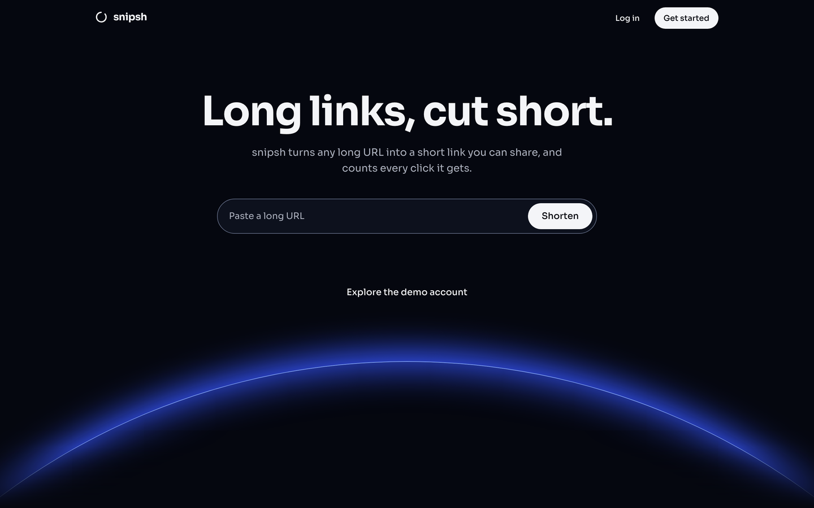
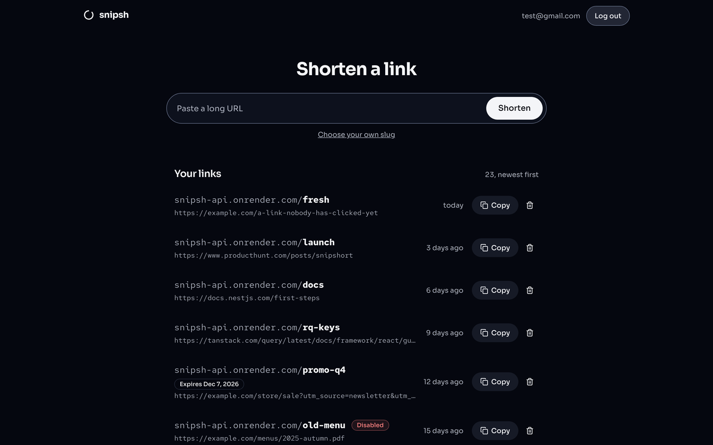
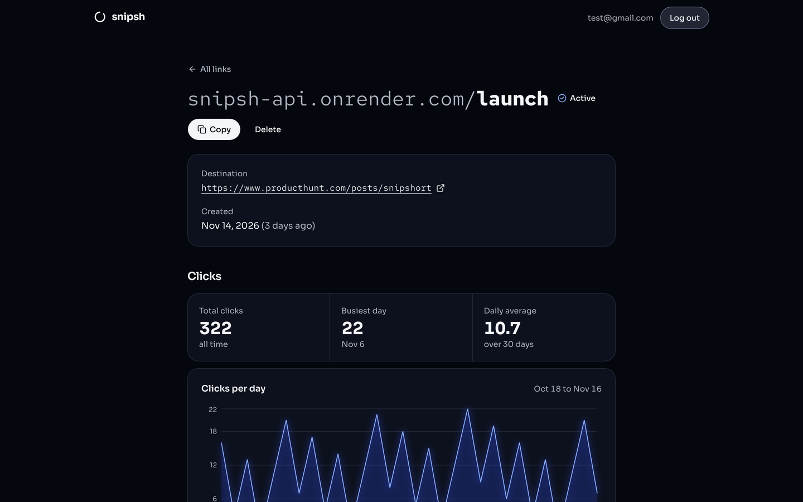

# snipsh

**snipsh** is a URL shortener. The name is short for **snip short**: it snips a long link down to a short one, and the name itself is snipped short too.

This repository holds both halves: the NestJS API and the React web app.

| App | Folder | Live |
| --- | --- | --- |
| API | [`apps/api`](apps/api) | https://snipsh-api.onrender.com |
| Web | [`apps/web`](apps/web) | https://snipsh-swya.vercel.app |

## Screenshots

The landing page, the links page and a link's details page. The links and click figures come from the sample data in the web app's mock API, not from real traffic.







## Running it

Each app has its own `package.json` and is installed and run from its own folder:

```bash
cd apps/api && yarn && yarn start:dev
cd apps/web && yarn && yarn dev
```
